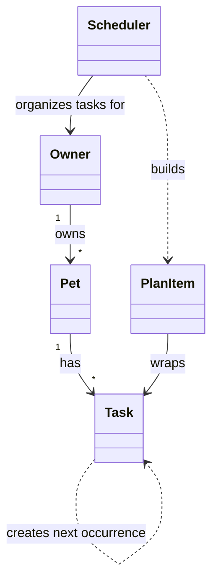

# PawPal+ (Module 2 Project)

You are building **PawPal+**, a Streamlit app that helps a pet owner plan care tasks for their pet.

## Scenario

A busy pet owner needs help staying consistent with pet care. They want an assistant that can:

- Track pet care tasks (walks, feeding, meds, enrichment, grooming, etc.)
- Consider constraints (time available, priority, owner preferences)
- Produce a daily plan and explain why it chose that plan

Your job is to design the system first (UML), then implement the logic in Python, then connect it to the Streamlit UI.

## What you will build

Your final app should:

- Let a user enter basic owner + pet info ✅ pets are added with a name and species; the owner is created automatically
- Let a user add/edit tasks (duration + priority at minimum) ✅ tasks are added with time, duration, priority and frequency (editing and deleting in the app is listed under Known limitations)
- Generate a daily schedule/plan based on constraints and priorities ✅ the **Suggested Daily Plan** places high-priority tasks first and avoids overlaps
- Display the plan clearly (and ideally explain the reasoning) ✅ every row says whether the task is "on time" or "moved from" its requested time
- Include tests for the most important scheduling behaviors ✅ 28 pytest tests

## Getting started

### Setup

```bash
python -m venv .venv
source .venv/bin/activate  # Windows: .venv\Scripts\activate
pip install -r requirements.txt
```

### Suggested workflow

1. Read the scenario carefully and identify requirements and edge cases.
2. Draft a UML diagram (classes, attributes, methods, relationships).
3. Convert UML into Python class stubs (no logic yet).
4. Implement scheduling logic in small increments.
5. Add tests to verify key behaviors.
6. Connect your logic to the Streamlit UI in `app.py`.
7. Refine UML so it matches what you actually built.

### Run it

```bash
python main.py                      # CLI demo of every feature (writes demo_data.json)
python -m streamlit run app.py      # Streamlit app (saves to data.json)
python -m pytest                    # test suite
```

## 🖥️ Sample Output

Real output of `python main.py` (colors only appear in a real terminal; set `NO_COLOR=1` to turn them off):

```
🐾 PawPal+ demo for Naviyah (Bella the Dog, Milo the Cat)

1. Today's schedule (sorted by time, all pets)
----------------------------------------------
┌────┬─────────────┬───────┬─────────────────────┬───────────┬────────┐
│    │ Time        │ Pet   │ Task                │ Priority  │ Length │
├────┼─────────────┼───────┼─────────────────────┼───────────┼────────┤
│ ⬜ │ 08:00-08:30 │ Bella │ Walk Bella          │ 🔴 high   │ 30 min │
│ ⬜ │ 08:15-08:35 │ Milo  │ Play with Milo      │ 🟢 low    │ 20 min │
│ ⬜ │ 09:00-09:10 │ Bella │ Give Bella medicine │ 🔴 high   │ 10 min │
│ ⬜ │ 12:00-12:20 │ Bella │ Brush Bella         │ 🟢 low    │ 20 min │
│ ⬜ │ 12:00-12:10 │ Milo  │ Feed Milo           │ 🟡 medium │ 10 min │
│ ⬜ │ 18:00-18:15 │ Bella │ Feed Bella          │ 🔴 high   │ 15 min │
│ ⬜ │ 18:00-18:15 │ Milo  │ Clean litter box    │ 🟡 medium │ 15 min │
└────┴─────────────┴───────┴─────────────────────┴───────────┴────────┘

2. Sorted by priority (high first, then time)
---------------------------------------------
┌────┬─────────────┬───────┬─────────────────────┬───────────┬────────┐
│    │ Time        │ Pet   │ Task                │ Priority  │ Length │
├────┼─────────────┼───────┼─────────────────────┼───────────┼────────┤
│ ⬜ │ 08:00-08:30 │ Bella │ Walk Bella          │ 🔴 high   │ 30 min │
│ ⬜ │ 09:00-09:10 │ Bella │ Give Bella medicine │ 🔴 high   │ 10 min │
│ ⬜ │ 18:00-18:15 │ Bella │ Feed Bella          │ 🔴 high   │ 15 min │
│ ⬜ │ 12:00-12:10 │ Milo  │ Feed Milo           │ 🟡 medium │ 10 min │
│ ⬜ │ 18:00-18:15 │ Milo  │ Clean litter box    │ 🟡 medium │ 15 min │
│ ⬜ │ 08:15-08:35 │ Milo  │ Play with Milo      │ 🟢 low    │ 20 min │
│ ⬜ │ 12:00-12:20 │ Bella │ Brush Bella         │ 🟢 low    │ 20 min │
└────┴─────────────┴───────┴─────────────────────┴───────────┴────────┘

3. Filtering
------------
Bella's tasks:
┌────┬─────────────┬───────┬─────────────────────┬──────────┬────────┐
│    │ Time        │ Pet   │ Task                │ Priority │ Length │
├────┼─────────────┼───────┼─────────────────────┼──────────┼────────┤
│ ⬜ │ 08:00-08:30 │ Bella │ Walk Bella          │ 🔴 high  │ 30 min │
│ ⬜ │ 09:00-09:10 │ Bella │ Give Bella medicine │ 🔴 high  │ 10 min │
│ ⬜ │ 12:00-12:20 │ Bella │ Brush Bella         │ 🟢 low   │ 20 min │
│ ⬜ │ 18:00-18:15 │ Bella │ Feed Bella          │ 🔴 high  │ 15 min │
└────┴─────────────┴───────┴─────────────────────┴──────────┴────────┘

4. Recurring task
-----------------
Completed 'Give Bella medicine' dated 2026-11-16
Next occurrence automatically scheduled for 2026-11-17
Incomplete tasks remaining: 7

5. Conflict detection (overlapping time blocks)
-----------------------------------------------
⚠️  Conflict on 2026-11-16: Bella: Walk Bella (08:00-08:30) overlaps Milo: Play with Milo (08:15-08:35)
⚠️  Conflict on 2026-11-16: Bella: Brush Bella (12:00-12:20) overlaps Milo: Feed Milo (12:00-12:10)
⚠️  Conflict on 2026-11-16: Bella: Feed Bella (18:00-18:15) overlaps Milo: Clean litter box (18:00-18:15)

6. Time-blocked daily plan (incomplete tasks, no overlaps, high priority first)
-------------------------------------------------------------------------------
┌─────────────┬───────┬──────────────────┬───────────┬────────────────────┐
│ Time        │ Pet   │ Task             │ Priority  │ Note               │
├─────────────┼───────┼──────────────────┼───────────┼────────────────────┤
│ 08:00-08:30 │ Bella │ Walk Bella       │ 🔴 high   │ on time            │
│ 08:30-08:50 │ Milo  │ Play with Milo   │ 🟢 low    │ ↪ moved from 08:15 │
│ 12:00-12:10 │ Milo  │ Feed Milo        │ 🟡 medium │ on time            │
│ 12:10-12:30 │ Bella │ Brush Bella      │ 🟢 low    │ ↪ moved from 12:00 │
│ 18:00-18:15 │ Bella │ Feed Bella       │ 🔴 high   │ on time            │
│ 18:15-18:30 │ Milo  │ Clean litter box │ 🟡 medium │ ↪ moved from 18:00 │
└─────────────┴───────┴──────────────────┴───────────┴────────────────────┘

7. Next available slot
----------------------
A 15-minute task fits at: 08:35
A 60-minute task fits at: 08:35
A 240-minute task fits at: 12:20

8. Persistence (JSON save and load)
-----------------------------------
Saved to demo_data.json (2458 bytes)
Reloaded 2 pets and 8 tasks (original had 8 tasks)
Same data after reload: True
```

## 🧪 Testing PawPal+

PawPal+ uses automated tests with pytest to make sure the main scheduling features work correctly.

### Run Tests

Use the following command in the terminal:

```bash
python -m pytest
```

(`python -m pytest -v` also prints each test name.)

### What the Tests Cover

The 28 tests in `tests/test_pawpal.py` check these core behaviors of PawPal+:

- **Task completion:** tasks can be marked as completed.
- **Task, pet and owner management:** tasks can be added to and removed from a pet, the owner collects tasks from all pets, duplicate pet names are rejected, and invalid times, priorities, durations and tasks that run past midnight are rejected (6 tests).
- **Sorting:** tasks are in chronological order across pets, unpadded times like `9:00` sort before `10:00`, and priority sorting puts high first then earliest time (3 tests).
- **Filtering:** tasks can be filtered by pet, by completion status, and by both together.
- **Recurring tasks:** daily and weekly tasks create the correct next occurrence, one-time tasks never repeat, and `Pet.complete_task()` stores the next copy with the same priority and duration (4 tests).
- **Conflict detection:** same start time, overlapping blocks with different starts, back-to-back tasks (not a conflict), tasks on different days, and completed tasks are ignored (5 tests).
- **Next available slot:** skips busy blocks across pets, uses a gap when it fits, and returns `None` when the day is full (3 tests).
- **Daily plan:** no overlaps, lower-priority tasks are moved, and tasks that cannot fit are reported (2 tests).
- **Persistence:** JSON save/load round trip, and missing or corrupt files fall back safely (2 tests).
- **Formatting:** status icons and tables contain the task details (2 tests).

### Sample test output

```
============================= test session starts =============================

tests/test_pawpal.py::test_task_completion PASSED                        [  3%]
tests/test_pawpal.py::test_task_addition PASSED                          [  7%]
tests/test_pawpal.py::test_remove_task PASSED                            [ 10%]
tests/test_pawpal.py::test_owner_collects_tasks_from_all_pets PASSED     [ 14%]
tests/test_pawpal.py::test_duplicate_pet_name_rejected PASSED            [ 17%]
tests/test_pawpal.py::test_invalid_task_inputs_rejected PASSED           [ 21%]
tests/test_pawpal.py::test_sort_by_time_orders_across_pets PASSED        [ 25%]
tests/test_pawpal.py::test_sort_handles_unpadded_times PASSED            [ 28%]
tests/test_pawpal.py::test_sort_by_priority_high_first_then_time PASSED  [ 32%]
tests/test_pawpal.py::test_filter_by_pet_and_completion PASSED           [ 35%]
tests/test_pawpal.py::test_daily_recurrence_creates_next_day PASSED      [ 39%]
tests/test_pawpal.py::test_weekly_recurrence_creates_next_week PASSED    [ 42%]
tests/test_pawpal.py::test_one_time_task_does_not_recur PASSED           [ 46%]
tests/test_pawpal.py::test_complete_task_adds_next_occurrence_to_pet PASSED [ 50%]
tests/test_pawpal.py::test_conflict_detected_for_same_time_across_pets PASSED [ 53%]
tests/test_pawpal.py::test_overlapping_blocks_conflict_even_with_different_start_times PASSED [ 57%]
tests/test_pawpal.py::test_back_to_back_tasks_are_not_a_conflict PASSED  [ 60%]
tests/test_pawpal.py::test_no_conflict_on_different_days PASSED          [ 64%]
tests/test_pawpal.py::test_completed_tasks_do_not_conflict PASSED        [ 67%]
tests/test_pawpal.py::test_next_available_slot_skips_busy_blocks_across_pets PASSED [ 71%]
tests/test_pawpal.py::test_next_available_slot_uses_a_gap_when_it_fits PASSED [ 75%]
tests/test_pawpal.py::test_next_available_slot_returns_none_when_day_is_full PASSED [ 78%]
tests/test_pawpal.py::test_daily_plan_has_no_overlaps_and_moves_lower_priority PASSED [ 82%]
tests/test_pawpal.py::test_daily_plan_reports_tasks_that_do_not_fit PASSED [ 85%]
tests/test_pawpal.py::test_save_and_load_round_trip PASSED               [ 89%]
tests/test_pawpal.py::test_load_or_create_handles_missing_and_corrupt_files PASSED [ 92%]
tests/test_pawpal.py::test_status_icon PASSED                            [ 96%]
tests/test_pawpal.py::test_format_schedule_and_plan_include_task_details PASSED [100%]

============================== 28 passed in 0.05s ==============================
```

## 📐 Smarter Scheduling

| Feature            | Method(s)                                      | Notes                                                                                         |
| ------------------ | ---------------------------------------------- | --------------------------------------------------------------------------------------------- |
| Task sorting       | `Scheduler.sort_by_time()`                     | Converts `HH:MM` to minutes first, so `9:00` correctly sorts before `10:00`.                  |
| Priority sorting   | `Scheduler.sort_by_priority()`                 | High priority first, then earliest time.                                                      |
| Daily schedule     | `Scheduler.get_todays_schedule()`              | Finds tasks due today across all pets and sorts them by time.                                 |
| Filtering          | `Scheduler.filter_tasks()`                     | Filters tasks by pet name and/or completion status.                                           |
| Conflict handling  | `Scheduler.detect_conflicts()`                 | Warns when two incomplete tasks' time blocks overlap on the same date, even with different start times. Back-to-back tasks are not conflicts. |
| Recurring tasks    | `Task.mark_complete()`, `Pet.complete_task()`  | Creates the next daily or weekly occurrence and adds it to the pet automatically.             |
| Next free slot     | `Scheduler.find_next_available_slot()`         | Finds the first gap (08:00-20:00 by default) long enough for a new task, across all pets.     |
| Time-blocked plan  | `Scheduler.build_daily_plan()`                 | High-priority tasks keep their time; others move to the next free gap so nothing overlaps.    |
| Task completion    | `Task.mark_complete()`                         | Changes the task's `completed` status to `True`.                                              |
| Pet management     | `Owner.add_pet()` / `Pet.add_task()`           | Connects pets and their assigned care tasks (pet names must be unique).                       |
| Persistence        | `Owner.save_to_json()` / `Owner.load_from_json()` | Saves pets and tasks to JSON and loads them on the next run.                               |
| Application memory | `st.session_state`                             | Keeps the owner, pets, and tasks available when Streamlit reruns the application.             |

## 📸 Demo Walkthrough

Start the app with `python -m streamlit run app.py`, then follow along:

1. **Open PawPal+.** The Streamlit application opens with the PawPal+ dashboard. Any pets and tasks saved in `data.json` from an earlier run are loaded automatically.
2. **Add a pet.** Enter the pet's name and species, then select **Add Pet**. The new `Pet` object is stored in the owner's pet list. Adding a duplicate name shows an error.
3. **Schedule a task.** Select a pet, then enter a task description, time, duration, priority and frequency, and select **Add Task**. PawPal+ creates a `Task` object and assigns it to the selected pet.
4. **View today's schedule.** The application shows today's tasks for all pets in chronological order, with a priority badge and a ✅ or ⬜ status.
5. **Mark a task complete.** Select **Done** next to a task. If it repeats daily or weekly, PawPal+ creates and stores the next occurrence automatically.
6. **Check scheduling conflicts.** PawPal+ displays a warning for every pair of overlapping tasks, for example a 30-minute walk at 08:00 and a play session at 08:15.
7. **Review the suggested daily plan.** High-priority tasks keep their time and lower-priority tasks move to the next free gap. The Note column shows "on time" or "moved from".
8. **Find a free slot.** Enter how many minutes you need and select **Find next available slot** to get the first open time today.
9. **Review filtered tasks.** Filter by pet and by status (All, Incomplete, Completed) to quickly find specific tasks.
10. **Close and reopen.** Everything is saved to `data.json` after each change, so your pets and tasks are still there next time.

**Screenshot or video** *(optional)*: not included. Run the app with the command above to see it.

## 🧩 System Design and Classes

An **Owner** has many **Pets**, a **Pet** has many **Tasks**, and the **Scheduler** works across all of an owner's pets. The UML is in [`diagrams/uml.mmd`](diagrams/uml.mmd) (Mermaid source):



| Class | Responsibility | Key attributes | Key methods |
| --- | --- | --- | --- |
| `Task` | One care activity | `description`, `time` (HH:MM), `due_date`, `completed`, `frequency`, `duration_minutes`, `priority`, `pet_name` | `mark_complete()`, `end_time`, `to_dict()`, `from_dict()` |
| `Pet` | A pet and its tasks | `name`, `species`, `tasks` | `add_task()`, `get_tasks()`, `remove_task()`, `complete_task()` |
| `Owner` | The person and their pets | `name`, `pets` | `add_pet()`, `get_pet()`, `get_all_tasks()`, `save_to_json()`, `load_from_json()`, `load_or_create()` |
| `Scheduler` | Organizes tasks across all pets | `owner` | `get_todays_schedule()`, `sort_by_time()`, `sort_by_priority()`, `filter_tasks()`, `detect_conflicts()`, `find_next_available_slot()`, `build_daily_plan()` |
| `PlanItem` | One slot in a daily plan | `task`, `start`, `end`, `moved` | (data holder) |

How the algorithms work:

- **Conflicts:** each task is a block from its start to start + duration. Two incomplete tasks on the same date conflict if `A.start < B.end and B.start < A.end`.
- **Next free slot:** sort the busy blocks of all pets and sweep forward to the first gap that fits.
- **Daily plan:** tasks are placed highest priority first; each keeps its time if free, otherwise it moves to the first free gap after its requested time. This is greedy, so it is simple to explain but not guaranteed to move the fewest tasks.
- **Recurring tasks:** completing a daily or weekly task creates a copy dated one day or one week later.

## ⭐ Stretch Features

### Advanced algorithmic capability (next available slot)
`Scheduler.find_next_available_slot()` goes beyond the required features, works across all pets, and is covered by 3 tests. See sections 6 and 7 of the sample output. The agent workflow is documented in [`ai_interactions.md`](ai_interactions.md).

### Data persistence layer
- **Workflow:** `Owner.save_to_json(path)` writes the owner, pets and tasks (dates as ISO text). `Owner.load_from_json(path)` rebuilds them. `Owner.load_or_create(name, path)` is used by the app at startup: it loads `data.json` if it exists and is valid, otherwise it starts fresh. The app saves after every change (add pet, add task, mark done).
- **Files modified/added:** `pawpal_system.py` (`to_dict`/`from_dict` on `Task`, `Pet`, `Owner`, plus the save/load methods), `app.py` (load at startup, save after changes), `main.py` (save/load round trip in step 8), `tests/test_pawpal.py` (round-trip and corrupt-file tests). The runtime files `data.json` and `demo_data.json` are created automatically and listed in `.gitignore`.

### Advanced scheduling logic
Priority-based sorting plus time-blocking so scheduled tasks never overlap: `sort_by_priority()`, duration-aware `detect_conflicts()` and `build_daily_plan()`. CLI examples from the sample output above:

```
⚠️  Conflict on 2026-11-16: Bella: Walk Bella (08:00-08:30) overlaps Milo: Play with Milo (08:15-08:35)

│ 08:00-08:30 │ Bella │ Walk Bella       │ 🔴 high   │ on time            │
│ 08:30-08:50 │ Milo  │ Play with Milo   │ 🟢 low    │ ↪ moved from 08:15 │
```

The high-priority walk keeps its time and the low-priority play session shifts to the next free slot.

### Professional UI and output formatting
All formatting lives in [`formatting.py`](formatting.py) and uses only the standard library, so there is nothing extra to install:

- `priority_badge()`: 🔴/🟡/🟢 priority badges, colored with ANSI codes
- `status_icon()`: ✅ / ⬜ completion icons
- `colorize()` and `color_enabled()`: ANSI colors, switched off automatically when output is not a terminal (`NO_COLOR=1` forces off, `PAWPAL_COLOR=1` forces on)
- `format_table()`: box-drawn tables that line up even with emoji (uses `unicodedata` to measure width)
- `format_schedule()` and `format_plan()`: build the schedule and plan tables; `header()` prints section titles
- `app.py` uses the same icons in its `st.table` views

### Thorough AI model or prompt comparison
A structured comparison of two prompting strategies (what was asked, what was useful, what went wrong, and the decision) is in [`ai_interactions.md`](ai_interactions.md).

## Project Structure

```
pawpal_system.py     Task, Pet, Owner, Scheduler, PlanItem
formatting.py        emoji, ANSI colors, table output
main.py              CLI demo
app.py               Streamlit app
tests/test_pawpal.py pytest suite (28 tests)
diagrams/uml.mmd     Mermaid UML
reflection.md        design, tradeoffs and AI reflection
ai_interactions.md   agent workflow and prompt comparison
```

## Known Limitations

- Times are `HH:MM` strings for a single day, with no time zones, and a task cannot run past midnight.
- The Streamlit app can add tasks and mark them done, but cannot yet edit or delete them.
- The daily plan is greedy (highest priority first), so it is not guaranteed to move the fewest tasks.
- Recurring tasks are created when you complete one, not generated in advance.
- Pet names must be unique (case-insensitive).

## Reflection

See [`reflection.md`](reflection.md) for design decisions, tradeoffs, how AI was used and how correctness was verified.
